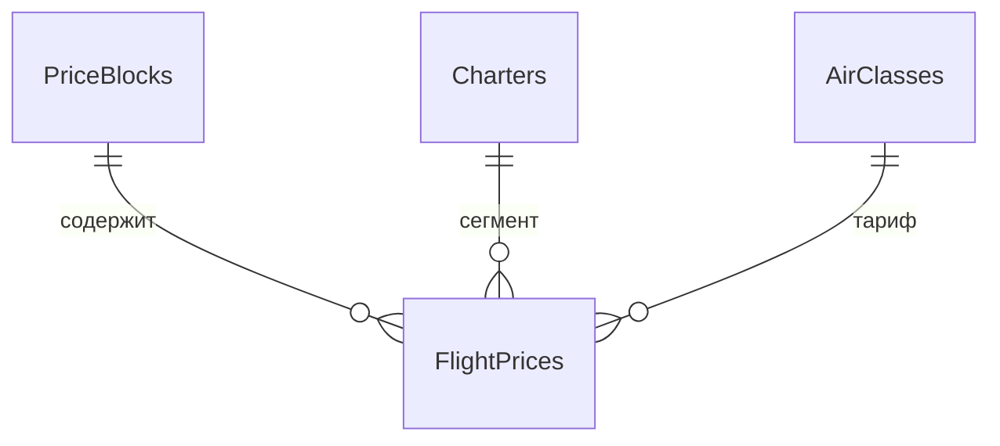

# Цены авиаперелётов

## Граница модели

Одна строка `FlightPrices` — цена одного пассажира на одном сегменте перелёта. Направление, города, аэропорты, авиакомпания, номер рейса и технические характеристики не копируются: они принадлежат `Charters`.

Услуга перелёта в туре может состоять из любого количества сегментов. Состав и порядок сегментов относятся к продукту/туру, а не к Pricing. Итоговая стоимость такой услуги складывается из цен найденных сегментов.

`PriceBlock` авиационной цены обязан иметь `ServiceTypeId = 1`. Его пакет, партнёр, основная валюта, состояние и общий период продаж в цене не дублируются.

## Поля FlightPrices

| Поле | Тип | Обяз. | Назначение |
|---|---|:---:|---|
| `Id` | integer identity | да | Идентификатор цены. |
| `PriceBlockId` | integer, FK | да | Авиационный ценовой блок. При удалении блока цена удаляется каскадно. |
| `CharterId` | integer, FK | да | Один продаваемый сегмент из `Charters`. Удаление используемого сегмента запрещено. |
| `AirClassId` | integer, FK | да | Тариф/класс из `AirClasses`. Это характеристика цены и не заменяется `Charters.AirClassCode`. |
| `TravelDateFrom` | date | да | Первая дата вылета, для которой действует цена. |
| `TravelDateTo` | date | да | Последняя дата вылета, для которой действует цена. |
| `DaysOfWeekMask` | smallint/flags | да | Дни вылета: Пн=1, Вт=2, Ср=4, Чт=8, Пт=16, Сб=32, Вс=64, все=127. |
| `SaleDateFrom` | date | нет | Дополнительная нижняя граница продажи этой цены. `NULL` — используется только ограничение блока. |
| `SaleDateTo` | date | нет | Дополнительная верхняя граница продажи. Границы могут задаваться независимо. |
| `AgeFrom` | smallint | нет | Минимальный возраст пассажира включительно на дату вылета. `NULL` — нижней границы нет. |
| `AgeTo` | smallint | нет | Максимальный возраст включительно. `NULL` — верхней границы нет. |
| `NettoAmount` | numeric(18,4) | нет | Нетто за одного пассажира на этот сегмент. |
| `BruttoAmount` | numeric(18,4) | нет | Брутто за одного пассажира на этот сегмент. Хотя бы одна из двух сумм обязательна. |
| `CurrencyId` | integer | нет | Валюта конкретной цены. При `NULL` используется `PriceBlock.CurrencyId`. |
| `Priority` | integer | да | Разрешение пересечений: большее значение важнее. |
| `CreatedByUserId` | varchar(200) | да | Пользователь, создавший цену. |
| `CreatedAt` | timestamptz | да | Дата создания в UTC. |
| `UpdatedAt` | timestamptz | нет | Дата последнего изменения в UTC. |

## Поиск и расчёт

1. Выбирается активный авиационный ценовой блок, подходящий по пакету, партнёру и дате продажи.
2. Для каждого сегмента услуги выбираются строки по `CharterId`, `AirClassId`, дате и дню недели вылета, периоду продажи и возрасту пассажира.
3. При пересечении альтернатив выбирается максимальный `Priority`. Одинаковый приоритет одинаково специфичных цен является конфликтом данных.
4. Для каждого пассажира определяется одна цена каждого сегмента. Возраст рассчитывается на дату вылета соответствующего сегмента.
5. Эффективная валюта равна `FlightPrice.CurrencyId ?? PriceBlock.CurrencyId`. Суммы разных валют нельзя складывать без явной конвертации.
6. Стоимость составной услуги равна сумме выбранных цен всех её сегментов и пассажиров.

`CharterSeasons` используется для проверки фактического расписания рейса, но цена не ссылается на конкретную запись расписания: одна цена может покрывать несколько сезонов одного `Charter`.

## API

CRUD доступен по `/api/pricing/flight-prices`. Список поддерживает фильтры `priceBlockId`, `charterId` и `airClassId`.
