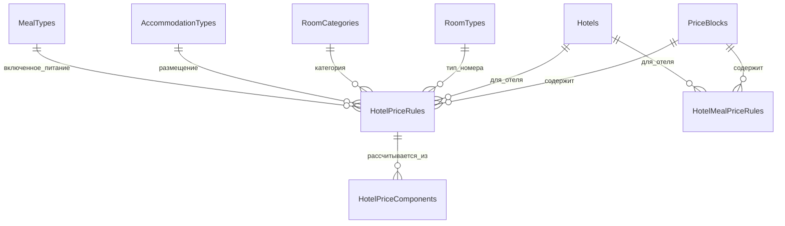

# Цены на проживание

## Назначение модели

Модель хранит исходные правила поставщика, а не заранее рассчитанные цены для всех составов туристов. Она поддерживает одновременно:

- готовую цену за конкретное размещение;
- цену за каждого гостя с различиями для основного и дополнительного места;
- базовую цену за стандартную загрузку и доплаты/скидки сверх неё;
- цену за номер, виллу или другой объект целиком;
- отдельные правила стоимости питания и upgrade питания.

Кэш и предварительный расчёт в этот срез не входят. Источником истины остаются правила в PostgreSQL.

## Связи

`PriceBlock` задаёт пакет, партнёра, тип услуги, основную валюту, период продаж и состояние публикации. Эти данные в строках цен не дублируются. Для гостиничных правил блок обязан иметь `ServiceTypeId = 3`.

Удаление блока каскадно удаляет его гостиничные правила. Удаление основного правила каскадно удаляет его компоненты. Ссылочные сущности общего каталога удалить нельзя, пока на них ссылается цена (`RESTRICT`).

## HotelPriceRules — основное правило проживания

| Поле | Тип | Обяз. | Назначение |
|---|---|:---:|---|
| `Id` | integer identity | да | Идентификатор правила. |
| `PriceBlockId` | integer, FK | да | Ценовой блок, которому принадлежит правило. |
| `HotelId` | integer, FK | да | Отель/круиз из `Hotels`. |
| `RoomTypeId` | integer, FK | да | Тип номера из `RoomTypes`. |
| `RoomCategoryId` | integer, FK | да | Категория номера из `RoomCategories`. |
| `AccommodationTypeId` | integer, FK | нет | Готовое размещение из `AccommodationTypes` (например DBL, SGL, 2AD+1CH). Обязательно для модели `FixedAccommodation`. |
| `MealTypeId` | integer, FK | нет | Питание, уже включённое в цену. Доплата за другое питание хранится отдельно. |
| `Model` | smallint/enum | да | Способ интерпретации правила, см. `HotelPriceModel`. |
| `Priority` | integer | да | Приоритет правила; большее число выигрывает среди одновременно подходящих правил. |
| `StayDateFrom` | date | да | Первый день проживания, для которого действует цена. |
| `StayDateTo` | date | да | Последний день проживания, для которого действует цена. |
| `CheckInDateFrom` | date | нет | Дополнительное ограничение по дате заезда; задаётся парой с `CheckInDateTo`. |
| `CheckInDateTo` | date | нет | Конец ограничения по дате заезда. |
| `DaysOfWeekMask` | smallint/flags | да | Дни проживания: Пн=1, Вт=2, Ср=4, Чт=8, Пт=16, Сб=32, Вс=64; все дни=127. |
| `MinNights` | smallint | нет | Минимальная длительность проживания. |
| `MaxNights` | smallint | нет | Максимальная длительность проживания. |
| `AgeCalculationDate` | smallint/enum | да | На какую дату определять возраст ребёнка: заезд или выезд. |
| `ApplicationUnit` | smallint/enum | да | За что задана базовая сумма: ночь, весь заезд, номер или человек. |
| `NettoAmount` | numeric(18,4) | нет | Нетто-сумма поставщика. |
| `BruttoAmount` | numeric(18,4) | нет | Продажная/брутто-сумма, если поставщик её задаёт. Достаточно одной из сумм. |
| `CurrencyId` | integer | нет | Валюта именно этого правила. Если `NULL`, используется `PriceBlock.CurrencyId`. Это позволяет цене отличаться валютой от блока. |
| `CreatedByUserId` | varchar(200) | да | Пользователь, создавший правило (JWT `sub`). |
| `CreatedAt` | timestamptz | да | Время создания в UTC. |
| `UpdatedAt` | timestamptz | нет | Время последнего изменения в UTC. |

## HotelPriceComponents — части формулы

Компоненты нужны только формульным моделям. Для `FixedAccommodation` они запрещены.

| Поле | Тип | Обяз. | Назначение |
|---|---|:---:|---|
| `Id` | integer identity | да | Идентификатор компонента. |
| `HotelPriceRuleId` | integer, FK | да | Родительское правило проживания. |
| `Type` | smallint/enum | да | Смысл компонента: цена гостя, доплата, скидка, single use, extra bed или infant. |
| `GuestType` | smallint/enum | нет | Взрослый, ребёнок или младенец. `NULL` — не зависит от типа гостя. |
| `PlacementType` | smallint/enum | да | Любое, основное, дополнительное или без места. Это поле заменяет грубые `AdultsCount`/`ChildrenCount`: фактический состав сопоставляется с размещением. |
| `AgeFrom` | smallint | нет | Минимальный возраст включительно. |
| `AgeTo` | smallint | нет | Максимальный возраст включительно. |
| `Operation` | smallint/enum | да | Установить сумму, прибавить/вычесть сумму либо процент. |
| `ApplicationUnit` | smallint/enum | да | Как часто и к чему применяется компонент. |
| `NettoAmount` | numeric(18,4) | нет | Нетто-сумма компонента для денежной операции. |
| `BruttoAmount` | numeric(18,4) | нет | Брутто-сумма компонента для денежной операции. |
| `Percent` | numeric(9,4) | нет | Процент для процентной операции; денежные суммы при этом не задаются. |
| `PercentageBase` | smallint/enum | нет | База, от которой считается процент. Обязательна для процентной операции. |
| `CreatedByUserId` | varchar(200) | да | Создатель компонента. |
| `CreatedAt` | timestamptz | да | Время создания в UTC. |
| `UpdatedAt` | timestamptz | нет | Время изменения в UTC. |

Компонент не имеет собственной валюты: он является частью формулы родительского правила и использует эффективную валюту правила.

## HotelMealPriceRules — питание и upgrade

`MealTypeId` основного правила означает уже включённое питание. Эта таблица хранит отдельную цену питания или переход, например `BB -> HB`.

| Поле | Тип | Обяз. | Назначение |
|---|---|:---:|---|
| `Id` | integer identity | да | Идентификатор правила питания. |
| `PriceBlockId` | integer, FK | да | Родительский ценовой блок. |
| `HotelId` | integer, FK | да | Отель. |
| `RoomTypeId` | integer, FK | нет | Ограничение по типу номера; `NULL` — любой. |
| `RoomCategoryId` | integer, FK | нет | Ограничение по категории; `NULL` — любая. |
| `AccommodationTypeId` | integer, FK | нет | Ограничение по размещению; `NULL` — любое. |
| `FromMealTypeId` | integer, FK | нет | Исходное питание. `NULL` означает отдельное добавление питания, а не upgrade. |
| `ToMealTypeId` | integer, FK | да | Питание, которое добавляется или до которого выполняется upgrade. |
| `StayDateFrom`, `StayDateTo` | date | да | Период проживания. |
| `CheckInDateFrom`, `CheckInDateTo` | date | нет | Необязательный период дат заезда; задаётся целиком. |
| `DaysOfWeekMask` | smallint/flags | да | Дни недели по той же битовой маске, что и у проживания. |
| `GuestType` | smallint/enum | нет | Тип гостя; `NULL` — любой. |
| `PlacementType` | smallint/enum | да | Основное/дополнительное/без места либо любое. |
| `AgeFrom`, `AgeTo` | smallint | нет | Возрастной диапазон включительно. |
| `ApplicationUnit` | smallint/enum | да | За человека/номер, за ночь/заезд. |
| `Operation` | smallint/enum | да | Способ добавления стоимости или скидки. |
| `NettoAmount`, `BruttoAmount` | numeric(18,4) | нет | Суммы денежной операции. |
| `Percent` | numeric(9,4) | нет | Значение процентной операции. |
| `PercentageBase` | smallint/enum | нет | База процентного расчёта. |
| `CurrencyId` | integer | нет | Валюта правила питания; при `NULL` наследуется валюта блока. |
| `Priority` | integer | да | Разрешение пересечений: большее значение важнее. |
| `CreatedByUserId`, `CreatedAt`, `UpdatedAt` | audit | да/да/нет | Автор и даты создания/изменения. |

## Значения enum

| Enum | Значения |
|---|---|
| `HotelPriceModel` | `1 FixedAccommodation`, `2 PerPerson`, `3 BaseOccupancy`, `4 WholeUnit` |
| `AgeCalculationDate` | `1 CheckIn`, `2 CheckOut` |
| `PriceGuestType` | `1 Adult`, `2 Child`, `3 Infant` |
| `PricePlacementType` | `0 Any`, `1 MainPlace`, `2 ExtraPlace`, `3 WithoutBed` |
| `PriceOperation` | `1 SetAmount`, `2 AddAmount`, `3 SubtractAmount`, `4 AddPercent`, `5 SubtractPercent` |
| `PriceApplicationUnit` | `1 PerStay`, `2 PerNight`, `3 PerRoomPerStay`, `4 PerRoomPerNight`, `5 PerPersonPerStay`, `6 PerPersonPerNight` |
| `HotelPriceComponentType` | `1 GuestPrice`, `2 GuestSupplement`, `3 GuestDiscount`, `4 SingleUseSupplement`, `5 ExtraBedSupplement`, `6 InfantPrice` |
| `PercentageBase` | `1 AdultMainPlacePrice`, `2 GuestBasePrice`, `3 RoomBasePrice`, `4 TotalBeforeComponent` |

## Принцип выбора и расчёта

1. Выбирается активный гостиничный `PriceBlock`, подходящий по пакету, партнёру, периоду продаж и валютным условиям.
2. Из `HotelPriceRules` отбираются строки по отелю, номеру, категории, размещению, питанию, периоду проживания, дате заезда, дням недели и длительности.
3. Если пересеклись альтернативные правила, выбирается максимальный `Priority`. Одинаковый приоритет у двух одинаково специфичных правил считается конфликтом данных, а не поводом молча сложить цены.
4. `FixedAccommodation` возвращает готовую сумму для выбранного размещения. `WholeUnit` задаёт стоимость объекта независимо от числа проживающих. `PerPerson` складывает подходящие компоненты по гостям. `BaseOccupancy` начинает с базовой суммы правила и применяет компоненты для отклонений от стандартного размещения.
5. Возраст ребёнка определяется на дату из `AgeCalculationDate`. Границы возраста включительны.
6. Денежные компоненты применяются согласно `ApplicationUnit`; процентные — к указанной `PercentageBase`. `SetAmount` заменяет базу своей области, операции `Add*`/`Subtract*` изменяют её.
7. После проживания применяются подходящие `HotelMealPriceRules`: отдельно для каждого гостя/места либо для номера согласно единице применения.
8. Эффективная валюта основного или пищевого правила: `rule.CurrencyId ?? priceBlock.CurrencyId`. Автоматическая конвертация не выполняется; объединять суммы разных валют можно только после явного валютного расчёта.

Текущий срез реализует хранение, проверки и CRUD. Исполняемый калькулятор по описанному алгоритму является следующим отдельным срезом; документация фиксирует контракт, под который он должен быть написан.

## HTTP API

- `/api/pricing/hotel-rules` — CRUD основных правил;
- `/api/pricing/hotel-rules/{ruleId}/components` — список и создание компонентов;
- `/api/pricing/hotel-rules/components/{id}` — чтение, изменение и удаление компонента;
- `/api/pricing/hotel-meal-rules` — CRUD правил питания.

Все операции записи проверяют существование ценового блока и объектов общего каталога. Доменные и SQL-ограничения дополнительно защищают диапазоны дат, возрастов, ночей, процентов и отрицательные суммы.
